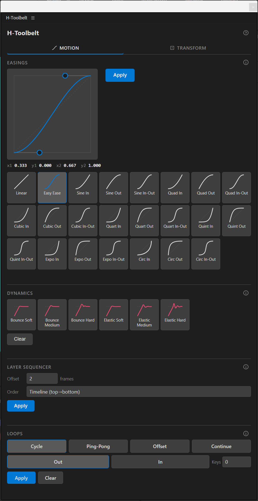
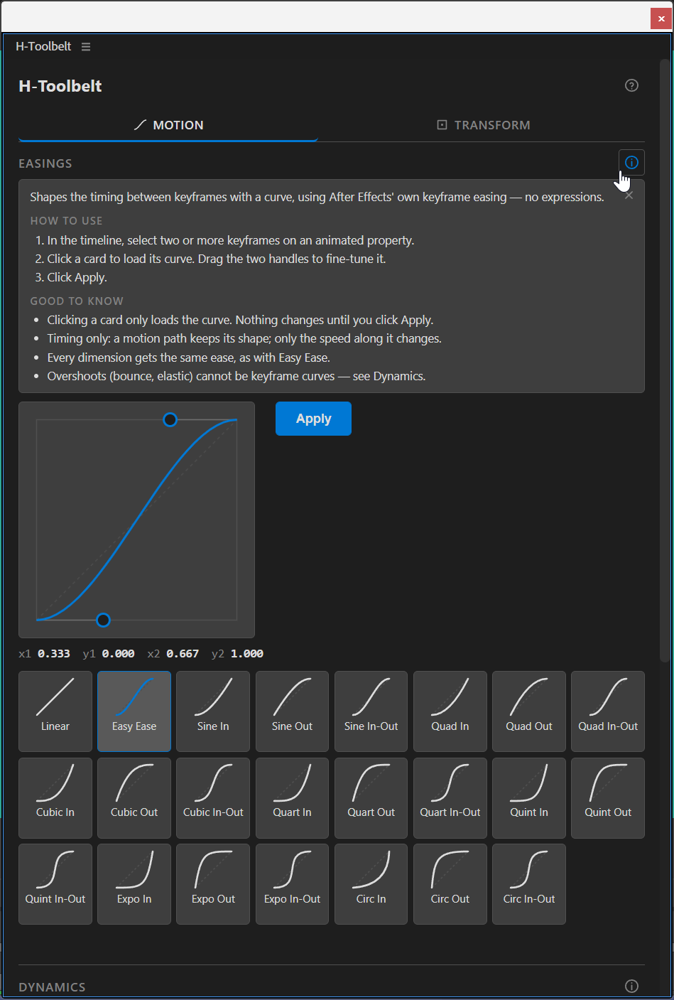

# H-Toolbelt

[](./LICENSE)
[](https://www.adobe.com/products/aftereffects.html)
[](https://github.com/huoston/H-Toolbelt/releases)

A motion-design toolbelt for Adobe After Effects — a single CEP panel that bundles
several everyday automation tools behind one dockable interface.



## What's inside

###  Motion

- **[Easings](./docs/easings.md)** — Shapes the timing between keyframes with a
  curve, using After Effects' own keyframe easing — no expressions.
- **[Dynamics](./docs/expressions.md)** — Adds a bounce or an elastic wobble after
  each keyframe. It is an expression, scaled by the speed the property arrives with.
- **[Layer Sequencer](./docs/sequencing.md)** — Staggers the selected layers in
  time, one after another.
- **[Loops](./docs/loop.md)** — Repeats the keyframed animation of a property beyond
  its keyframes, with a loop expression.

###  Transform

- **[Anchor Point](./docs/anchor-point.md)** — Moves a layer's anchor point to one of
  nine points of its bounding box, without the layer moving on screen.
- **[Align & Distribute](./docs/align.md)** — Aligns and spaces layers by what you see
  on screen, rotation and scale included.

## Help inside the panel

Every section has an 
button that opens a card with what the tool does, how to use it step by step, and
what is good to know.



## Install

1. Download the `.zxp` from the [latest release](https://github.com/huoston/H-Toolbelt/releases/latest).
2. Install it with the free [ZXP/UXP Installer](https://aescripts.com/learn/zxp-installer/).
3. Open it in After Effects from **Window → Extensions → H-Toolbelt**.

The [install guide](./docs/install.md) also covers updating, uninstalling and
troubleshooting.

## Compatibility

- **After Effects 18.4 (2021) or later**, on Windows and macOS. It runs offline.

Earlier versions are not supported because the panel needs the CEP 11 runtime
(Chromium 88), which After Effects gained in 18.4.

## In development

- **Loop and Dynamics on the same property.** Each writes its own expression today,
  so a property takes one or the other.
  [Issue #1](https://github.com/huoston/H-Toolbelt/issues/1)
- **Back, Elastic and Bounce easings between keyframes**, so an eased arrival can
  still overshoot. [Issue #2](https://github.com/huoston/H-Toolbelt/issues/2)
- **[Shape Layer Magic](./docs/shape-layer-magic.md)** is hidden until the Shapes tab
  has more tools.

## Documentation

| Page                                  | What it covers                                                                         |
| ------------------------------------- | -------------------------------------------------------------------------------------- |
| [Usage guides](./docs/README.md)      | One page per tool: steps, options with their real defaults, and every refusal message. |
| [Install guide](./docs/install.md)    | Installing, updating, uninstalling and troubleshooting.                                |
| [Known limitations](./LIMITATIONS.md) | What the tools deliberately will not do, and why.                                      |
| [Roadmap](./ROADMAP.md)               | What is committed for the next release, and what is only being considered.             |
| [Changelog](./CHANGELOG.md)           | What changed in each version.                                                          |
| [Contributing](./CONTRIBUTING.md)     | Building from source, the check suite, and how to submit changes.                      |

## Build from source

Requires [Node.js](https://nodejs.org/) 20 LTS (or newer) and
[Yarn](https://classic.yarnpkg.com/) (classic).

```bash
yarn install       # install dependencies
yarn build         # release build (minified), symlinked into the CEP extensions folder
yarn build:debug   # unminified build with sourcemaps, for development
yarn zxp           # build and package a signed .zxp into dist/zxp/
yarn dev           # run the panel with hot-module reload for development
```

`yarn build`, `yarn build:debug` and `yarn zxp` fail if `dist/` comes out incomplete.

Checks:

```bash
yarn test          # unit tests for the pure shared modules
yarn typecheck     # type-check the ExtendScript host and the Svelte UI
yarn smoke         # debug build + bundle symbol check + host ES3 check
```

To load an unsigned development build, enable CEP `PlayerDebugMode` for your
After Effects CSXS version, then open **Window → Extensions → H-Toolbelt**.

## License

Distributed under the **GNU General Public License v3.0 or later**
(`GPL-3.0-or-later`). See [LICENSE](./LICENSE) for the full text.

## Author

Dr. Huoston Rodrigues — <https://huoston.art/>

The same credit, the project links and the license are available inside the panel
from the 
button in its header.
