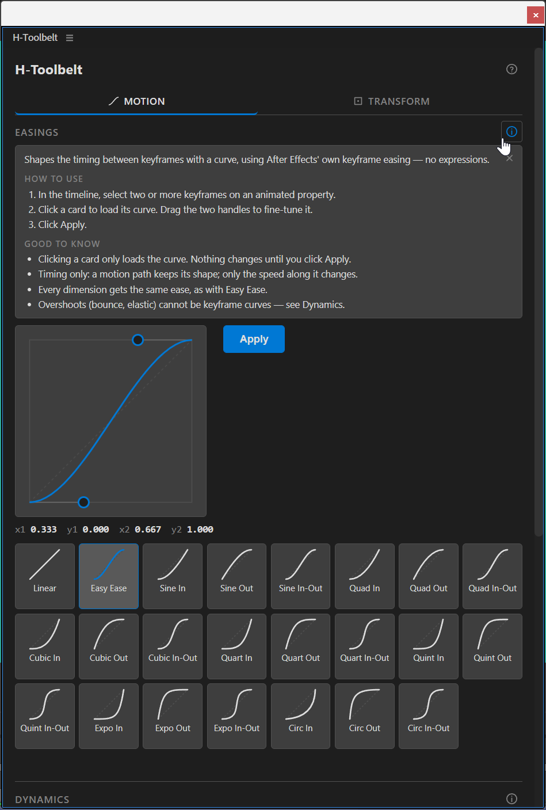
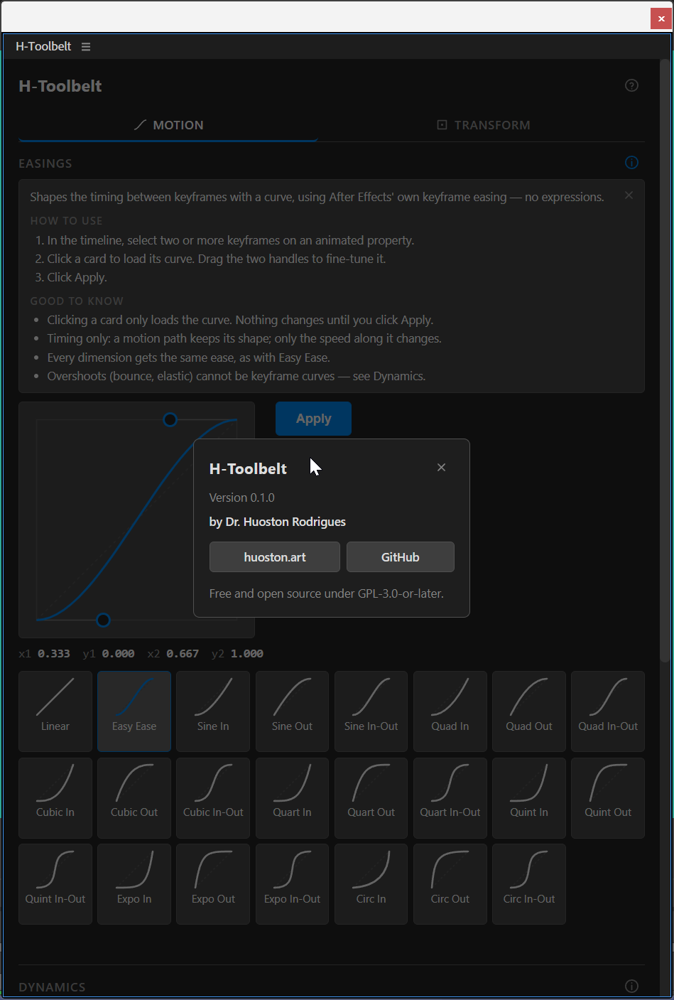

# H-Toolbelt documentation

Usage guides for each tool in the panel. Every guide lists the messages the tool
can show you and what they mean — the panel refuses work it cannot do safely, and
the message tells you why.

| Guide                              | What it covers                                                           |
| ---------------------------------- | ------------------------------------------------------------------------ |
| [Easings](./easings.md)            | Cubic-bezier keyframe easing from presets or the draggable curve editor. |
| [Dynamics](./expressions.md)       | One-click bounce and elastic expressions, and clearing expressions.      |
| [Layer Sequencer](./sequencing.md) | Staggering selected layers in time.                                      |
| [Loops](./loop.md)                 | Repeating an animation beyond its keyframes with a loop expression.      |
| [Anchor Point](./anchor-point.md)  | Moving a layer's anchor without the layer moving on screen.              |
| [Align & Distribute](./align.md)   | Aligning and spacing layers by their on-screen bounding box.             |
| [Install](./install.md)            | Installing, updating, uninstalling and troubleshooting.                  |

[Shape Layer Magic](./shape-layer-magic.md): Hidden in this version.

See also:

- [Known limitations](../LIMITATIONS.md) — what the tools deliberately will not do.
- [Roadmap](../ROADMAP.md) — what is next, and what is only being considered.

## Finding your way around the panel

- **Two tabs,** each with an icon *and* a label:
  
  **Motion** and
  
  **Transform**. On a very narrow docked panel the labels drop out and the icons
  remain; the tooltip still names each one.
- **Align and Distribute are icon-only**, because those alignments are spatial and
  the glyph reads faster than the word. Hover any of them for a tooltip naming
  exactly what it does.
- **Named controls stay as text** — easing and Dynamics cards, loop types,
  Apply/Clear. An icon for "Quint In-Out" would be a riddle, so those keep their
  names and gain tooltips.
- **Every button has a tooltip.** Nothing in the panel is a glyph you are expected
  to guess.

### Help on each tool

The  button at
the top of every section opens a card with what the tool does, how to use it step
by step, and what is good to know. The card sits above the controls and closes with
the same button, the × or `Esc`.

### About

The  button in
the panel header opens an About card with the version, the author, links to
[huoston.art](https://huoston.art/) and the
[GitHub repository](https://github.com/huoston/H-Toolbelt), and the license. Links
open in your normal browser rather than inside the panel. Close it with the × or
with `Esc`.

## A note on refusals

Most of the tools rewrite properties that already hold your work. Where the math
cannot provably cover a case, the tool skips it and tells you, rather than applying
something approximate that looks fine now and reveals itself as wrong much later.

So a message like `Expression on position: skipped (Ball) [ADBE AV Layer]` is not
an error. It is the tool declining a layer it cannot handle correctly, and naming
both the layer and its type so you can see exactly which one and why. The rest of
your selection is still processed.
