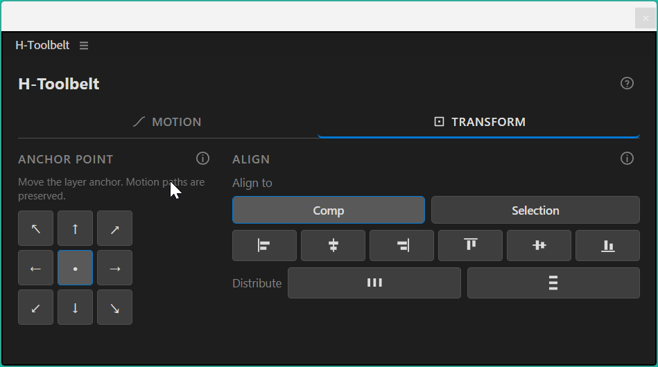

# Align & Distribute

## What it does

Aligns and distributes the selected layers by their bounding box **in
composition space** — the box you can actually see. After Effects' own Align
panel measures the layer's untransformed rectangle, which is why aligning a
rotated layer to the left edge leaves a visible gap. This tool projects the
layer's four corners through its position, anchor, scale and rotation first, so a
rotated or scaled layer lands where you expect.

Animated layers are moved, not refused: alignment is computed at the current
frame and the whole motion path shifts with it.

## How to use

1. Select the layers: one or more to align, two or more to distribute against the
   comp, three or more to distribute within the selection.
2. Pick what to align against — **Comp** or **Selection**.
3. Click one of the six align buttons, or one of the two distribute buttons.

It applies immediately — there is no separate Apply button.

## Options

### Align to

| Setting        | What the buttons below it act against                                 |
| -------------- | ----------------------------------------------------------------------- |
| **Comp**       | The composition frame. Default.                                         |
| **Selection**  | The combined bounding box of the selected layers, measured before any move. |

This is a mode, not an action: it changes what the buttons below it mean. It
governs **both** the six alignments **and** the two distributions.

### Align

| Button | Mode | What it does |
| ------ | ---- | ------------ |
|  | `left` | Left edges meet the target's left. |
|  | `hcenter` | Horizontal centers line up. |
|  | `right` | Right edges meet the target's right. |
|  | `top` | Top edges meet the target's top. |
|  | `vcenter` | Vertical centers line up. |
|  | `bottom` | Bottom edges meet the target's bottom. |

Each button moves one axis only, so a horizontal align never nudges a layer
vertically. That is what makes them composable — **left** then **top** puts a
layer in the corner.

### Distribute

| Button | Mode | What it does |
| ------ | ---- | ------------ |
|  | **Horizontal** | Spaces box centers evenly left to right. |
|  | **Vertical** | Spaces box centers evenly top to bottom. |

Distribution follows the same **Align to** toggle, and the two modes answer
different questions:

| Align to       | What distribution does                                                                 | Minimum |
| -------------- | ---------------------------------------------------------------------------------------- | ------- |
| **Comp**       | The outermost layer on each side is pushed until its **edge touches the comp frame**; the rest spread evenly between. Laying out. | 2 layers |
| **Selection**  | The two extremes stay exactly where they are; only what is between them moves. Tidying.  | 3 layers |

The minimums differ for a reason: spreading *within* a selection needs something
between the two ends to move, while spreading *across the comp* moves the ends
themselves, so two layers is already meaningful.

Order is taken from the layers' positions on screen, not from their timeline
order. Interior layers are spaced by **center**, so layers of differing size end
up evenly centered rather than evenly gapped — equal edge gaps is a different
operation and is on the roadmap.

## When it refuses (and why)

Refusals name the layer and its `matchName`, and the rest of the selection is
still processed.

| Message                                          | Why                                                                                          | What to do                                      |
| ------------------------------------------------ | ---------------------------------------------------------------------------------------------- | ------------------------------------------------- |
| `Open a composition first.`                       | No composition is active.                                                                     | Open or select a comp.                            |
| `Select one or more layers first.`                | Nothing eligible was selected.                                                                | Select at least one layer.                        |
| `Select 3+ layers to distribute.`                 | Fewer than three eligible layers, distributing within the selection.                          | Select at least three, or switch Align to: Comp.  |
| `Select 2+ layers to distribute.`                 | Fewer than two eligible layers, distributing across the comp.                                 | Select at least two.                              |
| `3D layers not supported yet`                     | A 3-D layer's on-screen box depends on the camera, which this version does not compute.       | Make the layer 2-D, or align it by hand for now.  |
| `Parented layers not supported yet`               | `position` is measured in the parent's space, so a comp-space move would land somewhere else. | Unparent, align, then re-parent.                  |
| `Separated position dimensions: skipped`          | X and Y are distinct properties a combined write cannot reach.                                | Re-join dimensions, align, separate again.        |
| `Position has an expression (not moved)`          | An expression would override the write, so the tool would report success while nothing moved. | Disable or bake the expression first.             |
| `Camera/Light has no bounds`                      | Cameras and lights have no source rectangle.                                                  | Nothing — they have no box to align.              |
| `No bounding box available`                       | After Effects returned no usable rectangle.                                                   | Check the layer has visible content at this time. |
| `Aligning shapes within a layer isn't supported yet - select layers instead.` | You selected shape groups inside a shape layer rather than layers. After Effects exposes no per-group bounding box to scripting. | Select the layers themselves. Per-group bounds are on the roadmap. |
| `Could not read composition bounds.`              | The composition's width or height came back unreadable, so there is no target to align to.    | Unusual; please open an issue naming your comp settings. |
| `Unreadable layer bounds: skipped`                | The layer's box worked out to a non-numeric value.                                            | Unusual; please open an issue with the `matchName` shown. |
| `Unreadable position values: skipped`             | After Effects would not hand over the position values while moving the layer.                 | Unusual; please open an issue with the `matchName` shown. |
| `No transform group` / `No anchor/position properties` / `Unreadable transform values: skipped` | The expected transform properties were missing or unreadable. | Unusual; please open an issue with the `matchName` shown. |
| `No bounding box available for unrecognized layer type` | Same as `No bounding box available`, on a layer type this build does not know. | Please open an issue with the `matchName` shown. |
| `Unknown align mode: X` / `Unknown align target: X` / `Unknown distribute axis: X` / `Unknown distribute target: X` | An unrecognized id reached the host. | Should not happen from the panel; please open an issue. |

On success: `Aligned 4 layer(s)` or `Distributed 5 layer(s)`, plus a
`; skipped N: <reason>` note when part of the selection was declined.

## Notes and limitations

- **A rotated layer has a bigger box than its artwork, on purpose.** The
  axis-aligned box of a square turned 45° is its diagonal wide. Aligning to the
  visual extent is the entire reason for measuring in comp space.
- **Everything is measured before anything moves.** "Align to selection" targets
  the union of the boxes as they are when you click, and distribution needs every
  center up front; reading them while layers were already moving would chase a
  target that keeps shifting.
- **Animated layers keep their motion path.** The whole position track shifts by
  the alignment delta — one constant vector — so the path keeps its shape, its
  keyframe count and its eases. Same behavior as [Anchor Point](./anchor-point.md);
  a layer that survives one survives the other.
- **Text and shape boxes are per-frame.** The box covers what is drawn at the
  current time, so alignment reflects that frame.
- **Re-running is safe.** A layer already at the target gets a zero delta and is
  left untouched rather than rewritten.
- The whole operation is a single undo step.

## Not in this version

Deferred to a later release, tracked on the [roadmap](../ROADMAP.md):

- **3-D layers and alignment in Z.** The geometry is written on 3-component
  points so depth is an added axis rather than a rewrite, but a 3-D layer's
  screen box depends on the active camera and that is not computed yet.
- **Align via Parent** — aligning a parented layer in its parent's space.
- **Align to a key layer** — picking one layer as the target instead of the comp
  or the whole selection.
- **Distribute by edge spacing** — equal gaps between boxes rather than equal
  spacing between centers.
- **Aligning shapes within a single layer.** Selecting several groups inside one
  shape layer is refused today. After Effects exposes no per-group bounding box
  to scripting — `sourceRectAtTime` reports the whole layer — which is the same
  wall the shape-layer cleanup hit. Doing it properly means deriving each group's
  bounds from its own path data.
