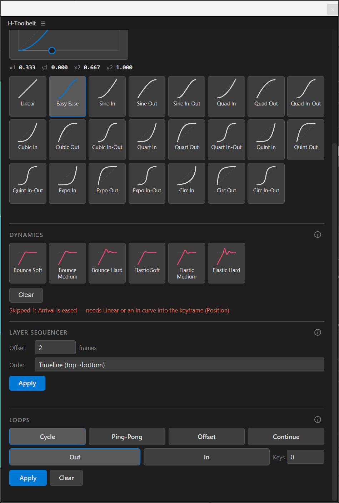

# Dynamics

## What it does

Writes a bounce or elastic expression onto the properties you have selected, in
one click, from the **Dynamics** section of the Motion tab. Both effects measure the
property's velocity going into each keyframe and add a decaying oscillation scaled
by it, so the overshoot inherits the speed of your animation instead of being a
fixed nudge. **Clear** removes
expressions again.

Parameters are baked into the generated expression text — no Expression Controls
are added to your layer.

## How to use

1. Select one or more **animated properties** in the timeline (click the property
   name, e.g. `Position`, not the layer).
2. Make sure the keyframes are reached at speed: Linear, or an In curve from
   [Easings](./easings.md).
3. Click one of the six cards. It applies immediately.

To remove expressions, select the properties and click **Clear**.

## Options

Six cards, three intensities of each effect. Each card draws its own curve over a
dashed line at the rest value, and hovering it shows what the motion does.
Clicking is the action, so no card stays highlighted.

| Preset         | Kind    | Amplitude | Frequency | Decay |
| -------------- | ------- | --------- | --------- | ----- |
| Bounce Soft    | bounce  | `0.05`    | `2`       | `8`   |
| Bounce Medium  | bounce  | `0.1`     | `2.5`     | `6`   |
| Bounce Hard    | bounce  | `0.18`    | `3`       | `4`   |
| Elastic Soft   | elastic | `0.05`    | `1.5`     | `7`   |
| Elastic Medium | elastic | `0.12`    | `2`       | `4`   |
| Elastic Hard   | elastic | `0.18`    | `2.5`     | `3.5` |

Amplitude is the strength of the overshoot, as a fraction of the sampled velocity.
Frequency is oscillations per second. Decay is how fast the oscillation dies out;
higher settles sooner. The two Medium presets are the values v0.1.0 applied by
default.

**Bounce** rectifies the oscillation so every lobe pushes the same way — an
object hitting a floor never passes through it. **Elastic** leaves it signed, so
it overshoots to both sides.

## When it refuses (and why)

Skipped properties are grouped by reason and named, e.g.
`Skipped 2: Needs 2+ keyframes (Rotation, Opacity)`. On partial success:
`Applied bounce to 3 properties; skipped 1: Already has an expression (not overwritten) (Scale)`.

| Message                                          | Why                                                                                                    | What to do                                                              |
| ------------------------------------------------ | ------------------------------------------------------------------------------------------------------- | ------------------------------------------------------------------------ |
| `Open a composition first.`                       | No composition is active.                                                                               | Open or select a comp.                                                   |
| `Select one or more animated properties first.`   | No property is selected — selecting a *group* such as `Transform` does not count as choosing a target.  | Click the property name itself in the timeline.                          |
| `Needs 2+ keyframes`                              | The effect scales the velocity into a keyframe. With fewer than two there is nothing to measure, so the expression would be inert. | Add a second keyframe.        |
| `Arrival is eased — needs Linear or an In curve into the keyframe` | The overshoot is scaled by the speed going into each keyframe. After Easy Ease or any Out / In-Out curve that speed is zero, so the effect would be invisible. | Set the keyframes' incoming ease to Linear (or apply Linear or an In curve from Easings), then apply again. |
| `Could not read keyframe values`                  | The arrival is measured before applying, and After Effects would not hand over the values.              | Unusual; please open an issue.                                           |
| `Already has an expression (not overwritten)`     | The property already carries an expression, which is never replaced.                                    | Clear it first if you really want to replace it.                         |
| `Property does not accept expressions`            | After Effects reports the property cannot take one.                                                     | Nothing to do for that property.                                         |
| `Unsupported property type`                       | Not a 1D/2D/3D numeric property — colors, masks, shape paths and text documents are excluded.           | Apply to a numeric property such as Position, Scale, Rotation, Opacity.  |
| `Unknown effect: X`                               | An unrecognized effect id reached the host.                                                             | Should not happen from the panel; please open an issue.                  |

When only some of a property's arrivals are eased, it still gets the effect and the
message ends with a warning such as `partial: Scale (1 of 3 arrivals eased)`:
those keyframes will not overshoot.

A property with every arrival eased is refused in the panel like this:

Very short segments (for Easy Ease, under about 9 frames) still keep a little speed,
so they bounce weakly instead of being skipped.

For **Clear**:

| Message                                     | Why                                                    |
| ------------------------------------------- | ------------------------------------------------------- |
| `Select one or more properties first.`      | No property selected.                                   |
| `No expressions to clear in the selection.` | None of the selected properties carried an expression.  |
| `Cleared N expressions`                     | Success.                                                |

## Notes and limitations

- **The expression text is ES3.** After Effects ships two expression engines, and
  a project switched to *Legacy ExtendScript* (File → Project Settings →
  Expressions) treats modern JavaScript syntax as a parse error, which would
  disable the expression with a yellow banner. The generated text avoids it, so
  the effects work under both engines.
- **Clear removes *any* expression in the selection**, not only the ones this
  tool wrote — including hand-written ones. "Clear" on a selection you made is
  unambiguous, and a filter that silently spared some expressions would be more
  surprising. Expressions written by this tool are identifiable by their
  `// H-Toolbelt` first line if you want to check before clearing.
- **Existing expressions are never overwritten.** Hand-written expression work is
  not something an undo you reach for a day later will bring back.
- **The effect starts after the last keyframe reached.** Before the first
  keyframe the expression falls through to the property's plain value, so the
  property behaves normally until the animation actually starts.
- **Clicking another card does not update already-applied expressions.** The
  values are baked into the text at the moment you click, and a property that
  already has an expression is refused. To retune, Clear and apply another card —
  or edit the `amp` / `freq` / `decay` variables directly at the top
  of the expression, which is plain readable code.
- **In development.** Using Dynamics and Loops on the same property:
  [issue #1](https://github.com/huoston/H-Toolbelt/issues/1). Back, Elastic and Bounce easings between keyframes, so an
  eased arrival can still overshoot: [issue #2](https://github.com/huoston/H-Toolbelt/issues/2).
- The whole operation is a single undo step.
