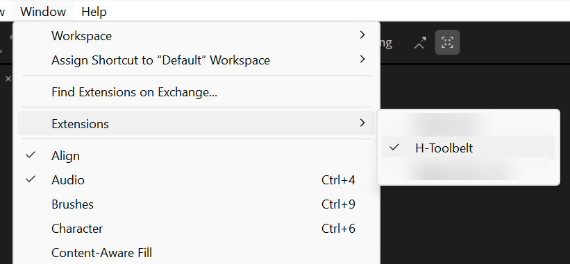

# Install, update and uninstall

## Requirements

- **After Effects 18.4 (2021) or later**, on Windows or macOS.
- **The Creative Cloud desktop app, kept up to date.** The installers below use
  Adobe's own installation tool (UPIA), which ships with it.

The `.zxp` is self-signed, so an installer may warn that the publisher cannot be
verified. That is expected: the signature proves the package has not been altered
since it was built.

## Install

### Option 1 — ZXP/UXP Installer (recommended)

1. Download the `.zxp` file attached to the
   [latest release](https://github.com/huoston/H-Toolbelt/releases/latest).
2. Quit After Effects.
3. Install the free [ZXP/UXP Installer](https://aescripts.com/learn/zxp-installer/)
   by aescripts + aeplugins.
4. Drag the `.zxp` onto the installer window and wait for the confirmation.
5. Open After Effects and choose **Window → Extensions → H-Toolbelt**.



### Option 2 — Adobe's command-line installer

Quit After Effects, open a terminal and go to the installer folder:

- **Windows** (Command Prompt):
  ```
  cd "C:\Program Files\Common Files\Adobe\Adobe Desktop Common\RemoteComponents\UPI\UnifiedPluginInstallerAgent"
  UnifiedPluginInstallerAgent.exe /install "C:\path\to\the-file.zxp"
  ```
- **macOS** (Terminal):
  ```
  cd "/Library/Application Support/Adobe/Adobe Desktop Common/RemoteComponents/UPI/UnifiedPluginInstallerAgent/UnifiedPluginInstallerAgent.app/Contents/MacOS"
  ./UnifiedPluginInstallerAgent --install "/path/to/the-file.zxp"
  ```

### Option 3 — Manual (last resort)

Use this only if both options above fail.

1. Quit After Effects.
2. Rename the `.zxp` file to `.zip` and unzip it.
3. Rename the unzipped folder to `com.huoston.htoolbelt`.
4. Move it into one of these folders, creating it if it does not exist:
   - **Windows, all users:** `C:\Program Files (x86)\Common Files\Adobe\CEP\extensions\` (needs administrator rights)
   - **Windows, current user:** `%APPDATA%\Adobe\CEP\extensions\`
   - **macOS, all users:** `/Library/Application Support/Adobe/CEP/extensions/` (needs an administrator password)
   - **macOS, current user:** `~/Library/Application Support/Adobe/CEP/extensions/`
5. Start After Effects and choose **Window → Extensions → H-Toolbelt**.

## Update

Install the new `.zxp` the same way you installed the first one — the installer
replaces the version already installed. Quit After Effects before installing and
start it again afterwards.

If you installed manually, delete the old `com.huoston.htoolbelt` folder first,
then copy the new one in its place.

## Uninstall

Quit After Effects first.

- **Command line:** in the installer folder from Option 2, list the installed
  extensions to find the exact name, then remove it:
  - Windows: `UnifiedPluginInstallerAgent.exe /list all`, then
    `UnifiedPluginInstallerAgent.exe /remove "<name>"`
  - macOS: `./UnifiedPluginInstallerAgent --list all`, then
    `./UnifiedPluginInstallerAgent --remove "<name>"`
- **Manually:** delete the `com.huoston.htoolbelt` folder from whichever
  extensions folder listed in Option 3 contains it.

## Troubleshooting

- **H-Toolbelt is not in Window → Extensions.** Quit After Effects completely
  and start it again. If it is still missing, install again with Option 1.
- **"The extension is not compatible with the installed applications."** Your
  After Effects is older than 18.4. Earlier versions run a panel engine that
  H-Toolbelt cannot use.
- **The panel opens blank.** [Open an issue](https://github.com/huoston/H-Toolbelt/issues/new?template=bug_report.md)
  with your After Effects version and operating system.
